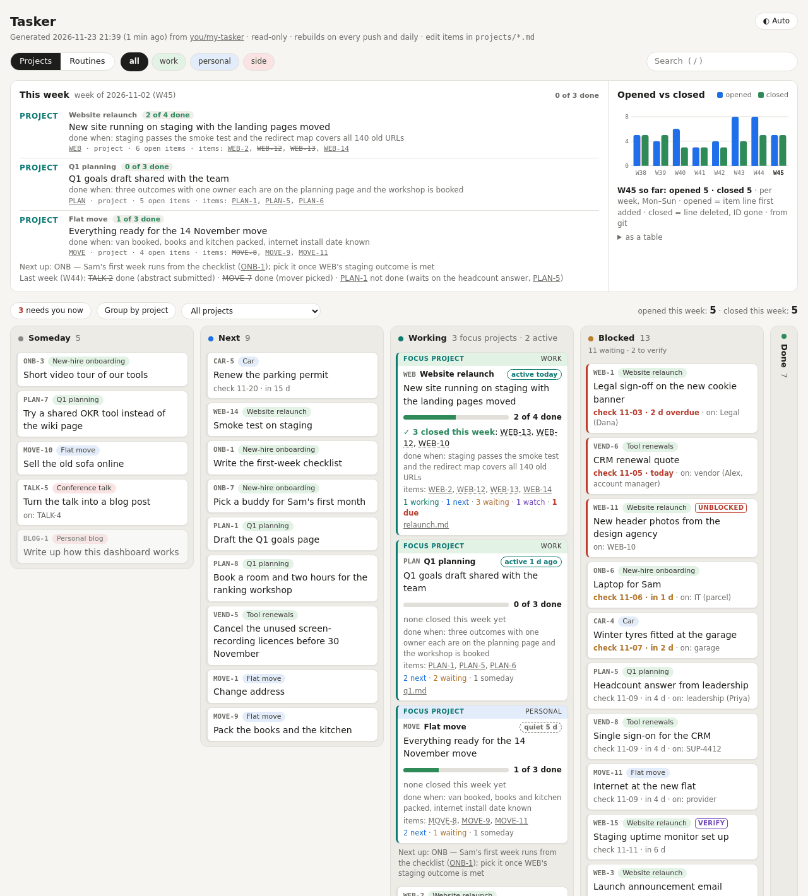

# Tasker

**One plain-text list of everything on your plate, kept up to date by you and your AI agents,
shown as a dashboard.**

<a href="https://xlysoft85.github.io/tasker-app/"><picture>
  <source media="(prefers-color-scheme: dark)" srcset="docs/img/board-dark.png">
  
</picture></a>

Each open item is one line of Markdown in a git repo:

```
- WEB-1 #waiting Legal sign-off on the cookie banner — copy sent 27 Oct; then: switch the banner on · check:2026-11-03 · on:Legal (Dana)
```

Tasker reads those files and builds a static dashboard, a kanban board, and a `TASKER.md` overview.
Up to three **focus projects** a week, picked in `FOCUS.md`, sit at the top of the board with their
progress and activity. The board shows what you can act on, what you're waiting on and since when,
and which check dates have come due. It flags waiting items whose blockers are finished, shows each
item's history, and lists what you finished this week. Progress, history and finished items all
come from git, so nobody has to keep a status field up to date.

**[Live demo →](https://xlysoft85.github.io/tasker-app/)** (built from [`example/`](example/) plus
two months of made-up git history from [`demo/`](demo/))

## Why plain text

- **Agents can maintain it.** Claude Code or any coding agent with a checkout updates an item in the
  same session that did the work, with no API, MCP server or extra tool. Setup for Claude Code
  (skill, session-start hook, permissions): [docs/claude-code.md](docs/claude-code.md). Other agents: [docs/agents.md](docs/agents.md).
- **Git is the history.** A finished item is a deleted line, and `git log -p` shows when and why.
- **Nothing to host.** The dashboard is one static HTML file. Put it on GitHub Pages, serve it from
  any box, or just read `TASKER.md` on GitHub.

## Item format

```
- <ID> #<state> <Title> — <note> · since:YYYY-MM-DD · check:YYYY-MM-DD · on:<what or whom> · doc:<repo/path#section>
```

Only `ID`, `#state` and `Title` are required. The note and the ` · key:value` fields are optional and
can come in any order. Indented lines under an item make a short sub-list.

| State | Meaning | Usually has |
|-------|---------|-------------|
| `#next` | You (or an agent) can act on it now | — |
| `#working` | Someone is on it right now. Rarely needed: items usually go from `#next` straight to done, and the focus project cards show what is moving | — |
| `#waiting` | Waiting on a thing, a person or another item | `on:`, `since:`, `check:` |
| `#watch` | Done, but verify when a condition holds | `check:` |
| `#someday` | Wanted, not planned | — |

- **`check:`** is the date to look again. On that date the item moves to *Needs you now*.
- **`on:`** names what it waits on. When it names other item IDs (`on:WEB-1, WEB-3`) and all of them
  are gone, the item shows as **unblocked**.
- **IDs** are `<PROJECT>-<n>`. Take the highest number in the file + 1 and never renumber.
- **Finished → delete the line.**

Projects are registered in `projects.yaml` (id, name, area, status, docs). Each active project has
a `projects/<ID>.md`. Typos, unknown states, duplicate IDs and orphan files show in a red box at the
top of the dashboard.

### Conventions

- **`#next` → done.** Most items never pass through `#working`: you act on a `#next` item and delete
  its line. What is in progress this week is the focus projects (below), and their progress is read
  from git.
- **Parking work on someone** (Legal, a vendor, another team): make it `#waiting` with `on:` and a
  `check:` date, and end the note with **`then: <first step when it clears>`**. Whoever picks the
  item up later, you or an agent, knows the next move without digging through the history.

  ```
  - VEND-6 #waiting CRM renewal quote — asked for a two-year price; then: compare it with the one-year price · check:2026-11-05 · on:vendor (Alex)
  ```

- **Ticket keys from another tracker** (`SUP-4412`, `HELP-311`) go in the note or in `on:`. Only IDs
  whose prefix is a project in `projects.yaml` count as items, so a ticket key stays plain text: it
  is never linked or struck through, and `on:SUP-4412` keeps the item blocked until you change it.
  Don't register a Tasker project whose ID is another tracker's prefix.

## The week's focus: `FOCUS.md`

`FOCUS.md` in the data repo holds the week's outcomes, three at most, usually written by a weekly
review (you, or a scheduled agent; see the demo's *Routines*). A pick is normally a **project**:

```
# Focus — week of 2026-11-02 (W45)

1. WEB — New site running on staging (items: WEB-2, WEB-12, WEB-13, WEB-14) · done when: staging passes the smoke test
2. PLAN — Q1 goals draft shared with the team (items: PLAN-1, PLAN-5, PLAN-6) · done when: three outcomes, one owner each
3. MOVE — Everything ready for the 14 November move (items: MOVE-8, MOVE-9, MOVE-11) · done when: van booked, boxes packed

Next up: ONB — Sam's first week runs from the checklist (ONB-1)
Last week (W44): TALK-2 done · MOVE-7 done · PLAN-1 not done (waits on PLAN-5)
```

- **Project pick** (`WEB`): must be a project in `projects.yaml`; an unknown one shows in the red
  *Format problems* box. It gets a **focus project card** at the top of *Working* (see below) and
  counts as done when the project has `status: done` (or is gone from `projects.yaml` after its
  items closed).
- **`(items: …)`**: the items that make up the outcome. The list is taken out of the outcome text
  and drives the card's progress bar (`2 of 4 done`); the IDs show as links, struck through once done.
- **Item pick** (`3. WEB-14 — Smoke test passes · done when: …`): the fallback for an outcome that
  is one item. It shows that item's current state, counts as done when its line is gone, and gets
  no card. One file may mix both kinds.
- **Other lines are notes**, shown under *This week*. A note starting `Next up:` also shows as a
  muted line under the focus project cards. Lines starting with `#` are ignored, except the heading.

## The page

One static `index.html` with its CSS and JavaScript inline: no server, no CDN, no build step.

- **This week**: the `FOCUS.md` picks with their live state and `n of m done`, next to **opened vs
  closed** per week for the last eight weeks: paired columns, a tooltip per week, and the same
  numbers as a table. An item counts as opened in the week its ID's line was first added (an edit,
  a state change or a move to another file is not an opening), and as closed in the week its line
  was deleted, if the ID is gone from every file. A week with no git data (before the repo's first
  commit, or no git checkout at all) is left empty rather than drawn as zero; the week of the first
  commit counts every item in it as opened. Above the board, *opened this week: N · closed this
  week: N* gives the current week (Monday to Sunday).
- **Board.** Columns *Someday* · *Next* · *Working* · *Blocked* · *Done*. *Blocked* holds `#waiting`
  items and `#watch` items, which carry a **verify** badge. A card shows its ID, project (in its
  area's colour), title, `check:` date and `on:`. Cards that need you now have a red edge and sort
  first: their check date has come, or everything they wait on is done (**unblocked**). Check dates
  are red when due and amber within three days.
- **Working** shows the week's **focus projects**: one card per open project pick, three at most,
  with its header counting them (`3 focus projects · 2 active`). Everything on a card that moves is
  read from the same `git log -p` pass, so nobody has to set a state for it to show progress:
  - an **activity chip**: `active today`, `active 1 d ago`, `active 2 d ago`, then `quiet 3 d` and
    up, from the last commit that added, changed or deleted a line of any of the project's items
    (any `WEB-n`, listed or not). `quiet` alone: no such change in the last 90 days.
  - a **progress bar**, `n of m done`, for the pick's `(items: …)` list (no list, no bar). An item
    counts as done when its line was deleted (the ID is gone from every file). A listed ID that is
    neither open nor in the last 90 days of history (a typo, or closed long ago) is left out of `m`.
  - **closed this week**: how many of the project's items closed Monday–today, with their IDs as
    links. This is the main progress signal, so it sits right under the bar.
  - then the outcome's *done when*, the listed items, open items by state, how many are due, and
    links to the project's `docs:` (labelled by file name, linked like `doc:`).

  ```
  FOCUS PROJECT                                         work
  WEB  Website relaunch                         active today
  New site running on staging with the landing pages moved
  █████████░░░░░░░░░  2 of 4 done
  ✓ 3 closed this week: WEB-13, WEB-12, WEB-10
  ```

  The cards follow the area chips. `#working` items, if you use the state, show under the cards.
  Without a git checkout there is no history, so no activity chip and no bar.
- **Project details.** Click a focus card (or open `…/#WEB`) to filter the board to that project and
  open its details: progress, activity, what closed this week and the open items. Then **Items · n
  of m done** lists the pick's `(items: …)` with their titles, state and check date (open first,
  then done ones struck through with `done <date>`, then IDs that never existed as `unknown ID`),
  and below it the **History** of the project's items, latest first.
- **Done drawer.** The narrow column on the right; click it to open. It lists items whose line was
  deleted in the last 7 days (the ID is gone from every file), with the date.
- **Card details.** Click a card, or open `…/#WEB-2`, to see every field: the note, the indented
  sub-lines, the `doc:` link, and the **history**. The history lists the commits that changed that
  item's line in the last 90 days, newest first, with the state change (`#next → #working`). Edits to
  the sub-lines alone are not counted.
- **Filters.** Area chips: `default_area` sets the first one, then each browser remembers your last
  choice. Also a project menu, a *needs you now* toggle, and **Group by project**, which gives each
  project its own row across the columns. **Search** (press `/`) matches ID, title, note, `on:` and
  project; `Esc` clears it.
- **Routines** view: what runs on its own, from `routines.yaml` (see below). Without that file the
  view is hidden.
- **Theme** follows the system. The button in the corner cycles *Auto → Light → Dark*, and each
  browser remembers the choice.
- The header shows how old the page is; with `stale_minutes` set, a red bar says the build has stopped.

The page needs JavaScript. Without it, read `TASKER.md`.

## Routines

`routines.yaml` in the data repo lists the jobs that run on their own: a cron job, a scheduled
agent, a CI workflow. The Routines view shows the list; Tasker does not run them or check that they
ran.

```yaml
- name: Friday review
  description: What closed, what is stuck; writes next week's picks to FOCUS.md
  schedule: "Fri 16:00"          # free text; quote a value that starts with *, or contains ": " or " #"
  runs_on: laptop, scheduled task
  account: personal agent        # free text: who or what it runs as
  status: active                 # active | paused | planned
  doc: handbook/planning/weekly-review.md   # like an item's doc: — a repo from tasker.yaml becomes a link
```

Only `name` is required, and `status` defaults to `active`. An unknown key, a bad status or a YAML
error shows in the red *Format problems* box. YAML reads ` #` as the start of a comment, so an unquoted
`description: drafts nudges for #waiting items` ends at "for". Quote such values.

## Quick start (GitHub Pages)

1. Copy the example into a new repo of your own:

   ```bash
   git clone https://github.com/xlysoft85/tasker-app
   mkdir my-tasker && cp -r tasker-app/example/. my-tasker/
   cd my-tasker && git init -b main && git add . && git commit -m "Start Tasker"
   ```

2. Create the repo on GitHub and push it.
3. In the repo's **Settings → Pages**, set *Source* to **GitHub Actions**.
4. Edit `tasker.yaml` (title, areas, links), replace the example projects with your own, write this
   week's `FOCUS.md` (or delete it), and push.

The included workflow ([`example/.github/workflows/tasker.yml`](example/.github/workflows/tasker.yml))
uses this repo as an action, pinned to `@v1`. It rebuilds when the items, `projects.yaml` or
`tasker.yaml` change and once a day, publishes the page and commits `TASKER.md` back when an item
changed. To pick up a newer Tasker, change the tag.

> **Private items?** GitHub Pages on a private repo needs a paid plan, and the page is still public
> unless you're on Enterprise Cloud. If that doesn't suit you, keep the repo private, delete the two
> Pages steps from the workflow and read `TASKER.md` on GitHub, or run Tasker on your own machine (below).

## Run it yourself

Needs Python 3.11+ and PyYAML.

```bash
python3 tasker.py --repo ~/my-tasker --site ~/tasker-site            # pull, build, commit + push TASKER.md
python3 tasker.py --repo ~/my-tasker --site /tmp/site --no-git       # local preview, touches no git
```

From cron every 15 minutes, serving `~/tasker-site` with any static web server:

```
*/15 * * * *  python3 /opt/tasker/tasker.py --repo ~/.local/share/tasker/data >> ~/tasker-build.log 2>&1
```

Give the build its **own checkout** of the data repo, separate from the one you edit by hand, so a
half-done edit is never pulled over or committed.

**Keep the code out of the data repo.** Anyone (or any agent) who can push items should not be able
to change the script that runs on your build host. Install a tagged release of this repo and
update it on purpose:

```bash
git clone --branch v1.6.1 https://github.com/xlysoft85/tasker-app /opt/tasker
```

## Configuration

`tasker.yaml` in the data repo. Every key is optional.

| Key | Default | What |
|-----|---------|------|
| `title` | `Tasker` | Page and `TASKER.md` heading |
| `areas` | areas used in `projects.yaml` | Allowed areas, in display order. Sets the filter chips and their colours |
| `source` | — | `{name, url}` for the header link to the data repo |
| `schedule` | — | Text shown in the header, e.g. `rebuilds every 15 min` |
| `refresh_minutes` | `15` | Page auto-reload; `0` turns it off |
| `stale_minutes` | `0` (off) | Red *stale* bar when the page is older than this — the build has stopped. Set it to about 3× your build interval; leave it off if you build only on push |
| `default_area` | `all` | Area chip selected on a browser's first visit; after that the browser remembers the last chip |
| `wip_limit` | — | Unused since 1.6.0 (it was the *Working* item limit). Allowed and ignored, so an old `tasker.yaml` needs no change |
| `focus` | `FOCUS.md` | File with the week's picks (see above). Missing file → no picks and no focus project cards, just the opened vs closed chart |
| `routines` | `routines.yaml` | File for the Routines view (see above). Missing file → no Routines view |
| `commit` | git's own identity | `{name, email}` for the `TASKER.md` commits |
| `repos` | — | `name: url` or `name: {url, branch}`. Turns `doc:<name>/<path>` into a link |

## Changes

See [CHANGELOG.md](CHANGELOG.md) and the [releases](https://github.com/xlysoft85/tasker-app/releases).

## Contributing

Issues and pull requests are welcome. Tasker is deliberately one file with one dependency, so please
keep it that way. Preview a change against the example with
`demo/history.sh /tmp/demo 2026-11-05 && python3 tasker.py --repo /tmp/demo --site /tmp/site --no-git --today 2026-11-05`.

## Licence

MIT
